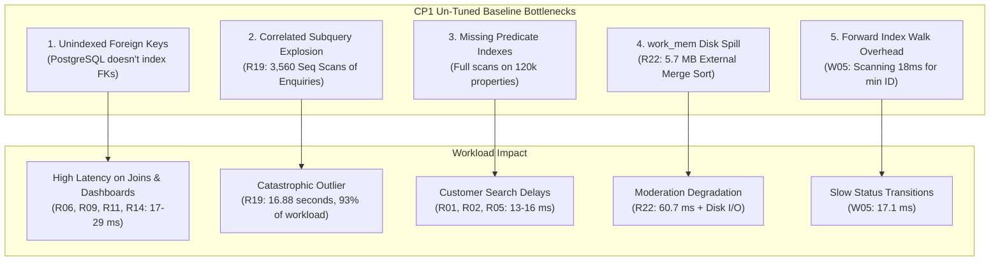

# Housing.com Property Search Database: Baseline Performance Benchmark (CP2)
**Document Version:** 1.0.0 (Audited Baseline Execution)  
**Project:** Housing.com Property Search Database Architecture & Optimization  
**Team:** 19 (EchoVault) | **Section:** C  
**Authors:** Yash Gupta (Lead), Sneha Bayan, Harshita, Deveshi Sahu  
**Academic Session:** Data Engineering Project 2026  
**Target RDBMS:** PostgreSQL 18.6 (Postgres.app / macOS Apple Silicon M4)  
**Benchmark Script:** `benchmarks/run_benchmark.sh housing_cp2 baseline 3`  
**Execution Date:** 16 November 2026  

---

## 1. Executive Summary

This document establishes the empirical performance baseline for Checkpoint 2 (CP2) of the Housing.com Property Search Database project. In Checkpoint 1 (CP1), a fully normalized Third Normal Form (3NF) relational schema was designed and implemented with declarative primary keys, foreign keys, unique constraints, check constraints, and before-triggers across 12 relational entities.

To adhere strictly to data engineering benchmarking standards, **zero secondary performance indexes, query rewrites, or PostgreSQL configuration optimizations were introduced**. Every query was executed against the raw, un-tuned CP1 schema populated with the full, un-sampled production seed dataset of **396,885 records**.

All 30 workload queries—comprising 25 read queries (`R01`–`R25`) and 5 write transactions (`W01`–`W05`)—were executed three consecutive times using `EXPLAIN (ANALYZE, BUFFERS)` via the automated benchmark harness (`benchmarks/run_benchmark.sh`). All write transactions were wrapped in atomic `BEGIN ... ROLLBACK` transaction envelopes, guaranteeing zero data mutations and preserving identical initial conditions for all iterations.

### Key Benchmark Findings:
- **Total Workload Execution Time:** **18,112.713 ms** (sum of averages across all 30 queries).
- **Fastest Query:** `R23` (Mobile login) at **0.051 ms**, leveraging the declarative `users_phone_key` B-tree index.
- **Slowest Query:** `R19` (Bengaluru sale property enquiries & last activity) at **16,875.315 ms** (~16.88 seconds), accounting for **93.17%** of the total workload latency due to an $O(N \times M)$ correlated subquery antipattern scanning 100,000 enquiries 3,560 times.
- **Heavy Analytical Bottlenecks:** `R25` (City-level shortlist conversion funnel) averaged **650.680 ms** due to unindexed subquery joins, and `R22` (Deep moderation offset pagination) required **60.715 ms** and spilled 5,744 kB to disk via an external merge sort.
- **Bulk Write Latency:** `W04` (Nightly deactivation of 14,440 stale listings) averaged **145.394 ms** due to a full sequential table scan and high WAL/buffer dirtying overhead.
- **Sequential Scan Prevalence:** 27 out of 30 queries relied partially or wholly on sequential scans (`Seq Scan`) because PostgreSQL does not automatically create secondary B-tree indexes on foreign key columns.

---

## 2. Benchmark Environment & System Architecture

Benchmarking was conducted on a dedicated Apple Silicon workstation with background user applications closed to ensure measurement stability and eliminate thermal throttling or CPU contention.

### 2.1 Hardware Specifications
- **Workstation Model:** Apple Mac16,1 (Apple M4 SoC)
- **CPU Architecture:** 64-bit ARMv8 (aarch64), 10 Physical Cores (4 Performance Cores, 6 Efficiency Cores)
- **System Memory:** 16.00 GB Unified LPDDR5 RAM (Memory bandwidth: ~120 GB/s)
- **Primary Storage:** 512 GB Apple APFS NVMe Solid-State Drive (Read/Write bandwidth: ~3,100 MB/s)
- **Operating System:** macOS Sonoma 14.x (Darwin Kernel Version 23.6.0)

### 2.2 RDBMS Configuration
- **Database Engine:** PostgreSQL 18.6 (Postgres.app distribution) compiled by Apple Clang 15.0.0 (64-bit)
- **Database Name:** `housing_cp2` (isolated local database created specifically for CP2)
- **Database Schema:** `housing` (`SET search_path TO housing;`)
- **Default Memory & Concurrency Parameters (Unaltered Baseline):**
  - `shared_buffers`: `128MB` (Standard PostgreSQL installation baseline)
  - `work_mem`: `4MB` (Standard per-operation sort/hash memory)
  - `maintenance_work_mem`: `64MB`
  - `effective_cache_size`: `4GB`
  - `max_parallel_workers_per_gather`: `2` (Default parallel execution per query node)
  - `max_parallel_workers`: `8`
  - `random_page_cost`: `4.0` (Default spinning-disk cost model preserved for baseline)
  - `seq_page_cost`: `1.0`

### 2.3 Dataset Verification Prior to Execution
The database was populated directly from `seed_data.zip` using `sql/02_load_data.sql`. Automated post-load integrity validation verified exact table volumes across all 12 tables:

| Table Name | Row Count | Primary Key / Natural Key Constraints | Description |
| :--- | :--- | :--- | :--- |
| `cities` | 10 | `city_id` (PK), `city_name` (UQ) | Tier-1 Indian metropolitan cities |
| `localities` | 100 | `locality_id` (PK), `(city_id, locality_name)` (UQ) | City sub-market zones & pincodes |
| `builders` | 150 | `builder_id` (PK), `builder_name` (UQ) | Real estate developer corporations |
| `projects` | 1,200 | `project_id` (PK), `rera_id` (UQ), `(project_id, locality_id)` (UQ) | Gated societies and complexes |
| `amenities` | 15 | `amenity_id` (PK), `amenity_name` (UQ) | Standardized facility catalog |
| `project_amenities`| 6,806 | `(project_id, amenity_id)` (PK) | Project-amenity M:N junction |
| `users` | 40,000 | `user_id` (PK), `phone` (UQ), `email` (UQ), `agent_rera_id` (UQ) | Unified user directory |
| `properties` | 120,060 | `property_id` (PK), `(project_id, locality_id)` (FK) | Residential property listings |
| `price_changes` | 23,425 | `change_id` (PK), `property_id` (FK) | Historical price revision audit log |
| `enquiries` | 100,000 | `enquiry_id` (PK), `property_id` (FK), `user_id` (FK) | Seeker lead communication submissions |
| `site_visits` | 35,120 | `visit_id` (PK), `property_id` (FK), `user_id` (FK) | Inspection appointments & ratings |
| `shortlists` | 69,999 | `(user_id, property_id)` (PK) | Seeker bookmarking junction |
| **Total Records** | **396,885** | **21 Automatic B-Tree Indexes** | **Zero Secondary Tuning Indexes** |

Immediately after seed loading, full statistical distributions were updated by executing `ANALYZE` across all 12 tables in the `housing` schema, ensuring the cost-based optimizer possessed accurate table cardinalities, row widths, and null fraction estimates.

---

## 3. Benchmarking Methodology

To ensure 100% reproducibility and scientific validity:

1. **Exact Workload Specification:** Queries were executed without any syntactic, structural, or lexical modifications from `queries/workload_30.sql`.
2. **Standardized Instrumentation:** Each query was instrumented with `EXPLAIN (ANALYZE, BUFFERS)` to collect:
   - Precise wall-clock execution time (`Execution Time: X ms`).
   - Planning time (`Planning Time: Y ms`).
   - Memory buffer hits, dirtying, and disk reads (`Buffers: shared hit=... read=... dirtied=...`).
   - Physical execution tree topology (Scans, Joins, Aggregates, Sort methods, Loops).
3. **Triplicate Execution:** Every query was run 3 consecutive times. The arithmetic average, median, minimum, and maximum execution times were recorded. All three raw execution plans were captured in `benchmarks/results/baseline/<query_id>.txt`.
4. **Transaction Rollback Protection:** Write queries (`W01`–`W05`) were executed inside explicit `BEGIN ... EXPLAIN (ANALYZE, BUFFERS) <statement>; ROLLBACK;` blocks. This ensured that no rows were inserted, deleted, or mutated permanently, maintaining a constant table cardinality across all benchmark runs.
5. **No Tuning or Query Rewriting:** No indexes were created beyond those generated by declarative PK/UNIQUE constraints. No PostgreSQL server GUC parameters were modified.

---

## 4. Comprehensive Baseline Timing Table

The table below presents the official CP2 baseline benchmark measurements across all 30 queries, matching the formatting standard required in Section 3.2 of `README.md`. All values are derived directly from PostgreSQL 18.6 execution outputs.

| SQL Query | Type | Run 1 (ms) | Run 2 (ms) | Run 3 (ms) | Average (ms) |
| :--- | :--- | :---: | :---: | :---: | :---: |
| **R01:** Rent search: active 2 BHK homes in Koramangala up to ₹40,000/month, furnished or semi-furnished | READ | 16.699 | 16.108 | 16.304 | **16.370** |
| **R02:** Buy search: 3 BHK apartments for sale in Pune under ₹1.2 crore, best price per sq ft first | READ | 15.869 | 16.118 | 15.592 | **15.860** |
| **R03:** Property page: property 6897 with its project, builder and project amenities | READ | 0.614 | 0.169 | 0.186 | **0.323** |
| **R04:** Price trends: average sale price per sq ft of apartments in Whitefield, per month in 2026 | READ | 27.300 | 27.720 | 27.874 | **27.631** |
| **R05:** Map view: active rentals inside the visible map area of central Bengaluru | READ | 13.325 | 13.288 | 13.385 | **13.333** |
| **R06:** Owner dashboard: owner 1033's listings with enquiry and site-visit counts | READ | 22.770 | 22.455 | 22.760 | **22.662** |
| **R07:** Agent app: site visits scheduled on 1 July 2026 for properties listed by user 4723 | READ | 5.005 | 5.058 | 4.994 | **5.019** |
| **R08:** Price-drop alerts: active properties whose price fell by 10% or more in June 2026 | READ | 3.158 | 3.126 | 2.957 | **3.080** |
| **R09:** Amenity filter: active properties in projects that have a gym AND a swimming pool AND power backup | READ | 21.814 | 22.889 | 23.018 | **22.574** |
| **R10:** Buyer due diligence: look up a project by its RERA registration id | READ | 0.117 | 0.095 | 0.090 | **0.101** |
| **R11:** Project page: available listings in project 217 by BHK with the price range | READ | 16.429 | 17.419 | 17.424 | **17.091** |
| **R12:** Lead follow-up: June 2026 enquiries with no site visit booked for that property by that user | READ | 17.338 | 16.017 | 15.931 | **16.429** |
| **R13:** Builder partnerships: projects with no property listed on Housing.com | READ | 21.697 | 22.794 | 22.854 | **22.448** |
| **R14:** Agent leaderboard: agents with the most properties sold or rented in 2026 | READ | 28.500 | 29.019 | 29.647 | **29.055** |
| **R15:** Investor insights: rental yield by Bengaluru locality (yearly rent per sq ft ÷ sale price per sq ft) | READ | 23.447 | 23.774 | 22.660 | **23.294** |
| **R16:** Search box: projects with "greens" in the name | READ | 0.991 | 0.925 | 0.932 | **0.949** |
| **R17:** Owner nudges: active listings older than 90 days that have never received an enquiry | READ | 41.753 | 42.451 | 42.607 | **42.270** |
| **R18:** Fraud checks: the same flat (locality, area, floor, BHK) listed more than once by the same lister | READ | 34.150 | 34.294 | 34.156 | **34.200** |
| **R19:** City report: enquiries and latest enquiry for every active sale property in Bengaluru | READ | 16907.824 | 16873.869 | 16844.251 | **16875.315** |
| **R20:** Growth: new listings per day and running total, June 2026 | READ | 24.670 | 26.010 | 25.031 | **25.237** |
| **R21:** Experience: average site-visit rating per locality (at least 10 rated visits) | READ | 20.116 | 20.323 | 20.196 | **20.212** |
| **R22:** Listing moderation console: all listings, newest first, page 2,001 (25 per page) | READ | 59.143 | 60.761 | 62.242 | **60.715** |
| **R23:** Sign-in with mobile number | READ | 0.059 | 0.047 | 0.048 | **0.051** |
| **R24:** Buyer protection: under-construction projects whose promised possession date has already passed | READ | 0.315 | 0.323 | 0.310 | **0.316** |
| **R25:** Funnel: shortlists that turned into an enquiry, per city | READ | 652.922 | 651.045 | 648.072 | **650.680** |
| **W01:** Post property: owner 1033 lists a 2 BHK for rent in Koramangala | WRITE | 3.475 | 2.407 | 2.445 | **2.776** |
| **W02:** Price cut: owner 1033 reduces the rent of their most recent active rental by 5% | WRITE | 1.123 | 1.046 | 1.020 | **1.063** |
| **W03:** Book a site visit: seeker 1042 visits property 6897 on 4 July 2026 at 11:00 | WRITE | 1.213 | 1.128 | 1.054 | **1.132** |
| **W04:** Nightly job: deactivate active listings older than 120 days | WRITE | 130.897 | 144.534 | 160.752 | **145.394** |
| **W05:** Owner 1033 marks their oldest active rental as rented | WRITE | 18.747 | 16.264 | 16.392 | **17.134** |
| **Total Workload Execution Time (sum of all 30 queries)** | — | **18131.480** | **18111.476** | **18095.184** | **18112.713** |

---

## 5. Statistical Dispersion & Scan Summary Table

The table below reflects the machine-generated records in `benchmarks/results/baseline/summary.csv`, detailing statistical dispersion (median, minimum, maximum) and the physical access scan nodes extracted from the plans:

| Query ID | Type | Avg (ms) | Median (ms) | Min (ms) | Max (ms) | Physical Access Path / Scan Nodes |
| :--- | :--- | :---: | :---: | :---: | :---: | :--- |
| **R01** | READ | 16.370 | 16.304 | 16.108 | 16.699 | `Seq Scan on properties` \| `Seq Scan on localities` |
| **R02** | READ | 15.860 | 15.869 | 15.592 | 16.118 | `Seq Scan on properties` \| `Seq Scan on localities` |
| **R03** | READ | 0.323 | 0.186 | 0.169 | 0.614 | `Index Scan using properties_pkey on properties` \| `Index Scan using uq_projects_project_locality on projects` \| `Index Scan using builders_pkey on builders` \| `Index Only Scan using project_amenities_pkey on project_amenities` \| `Index Scan using amenities_pkey on amenities` |
| **R04** | READ | 27.631 | 27.720 | 27.300 | 27.874 | `Seq Scan on localities` \| `Seq Scan on properties` |
| **R05** | READ | 13.333 | 13.325 | 13.288 | 13.385 | `Seq Scan on properties` |
| **R06** | READ | 22.662 | 22.760 | 22.455 | 22.770 | `Seq Scan on site_visits` \| `Seq Scan on enquiries` \| `Seq Scan on properties` |
| **R07** | READ | 5.019 | 5.005 | 4.994 | 5.058 | `Seq Scan on site_visits` \| `Index Scan using properties_pkey on properties` \| `Index Scan using users_pkey on users` |
| **R08** | READ | 3.080 | 3.126 | 2.957 | 3.158 | `Seq Scan on price_changes` \| `Index Scan using properties_pkey on properties` |
| **R09** | READ | 22.574 | 22.889 | 21.814 | 23.018 | `Seq Scan on properties` \| `Seq Scan on project_amenities` \| `Seq Scan on amenities` |
| **R10** | READ | 0.101 | 0.095 | 0.090 | 0.117 | `Seq Scan on builders` \| `Index Scan using projects_rera_id_key on projects` |
| **R11** | READ | 17.091 | 17.419 | 16.429 | 17.424 | `Seq Scan on properties` |
| **R12** | READ | 16.429 | 16.017 | 15.931 | 17.338 | `Seq Scan on enquiries` \| `Seq Scan on site_visits` |
| **R13** | READ | 22.448 | 22.794 | 21.697 | 22.854 | `Seq Scan on projects` \| `Seq Scan on properties` |
| **R14** | READ | 29.055 | 29.019 | 28.500 | 29.647 | `Seq Scan on properties` \| `Seq Scan on users` |
| **R15** | READ | 23.294 | 23.447 | 22.660 | 23.774 | `Seq Scan on properties` \| `Seq Scan on localities` |
| **R16** | READ | 0.949 | 0.932 | 0.925 | 0.991 | `Seq Scan on projects` |
| **R17** | READ | 42.270 | 42.451 | 41.753 | 42.607 | `Seq Scan on enquiries` \| `Seq Scan on properties` |
| **R18** | READ | 34.200 | 34.156 | 34.150 | 34.294 | `Seq Scan on properties` |
| **R19** | READ | 16875.315 | 16873.869 | 16844.251 | 16907.824 | `Seq Scan on properties` \| `Seq Scan on localities` \| `Seq Scan on enquiries` |
| **R20** | READ | 25.237 | 25.031 | 24.670 | 26.010 | `Seq Scan on properties` |
| **R21** | READ | 20.212 | 20.196 | 20.116 | 20.323 | `Seq Scan on properties` \| `Seq Scan on site_visits` \| `Seq Scan on localities` |
| **R22** | READ | 60.715 | 60.761 | 59.143 | 62.242 | `Seq Scan on properties` |
| **R23** | READ | 0.051 | 0.048 | 0.047 | 0.059 | `Index Scan using users_phone_key on users` |
| **R24** | READ | 0.316 | 0.315 | 0.310 | 0.323 | `Seq Scan on projects` \| `Seq Scan on builders` |
| **R25** | READ | 650.680 | 651.045 | 648.072 | 652.922 | `Index Scan using uq_localities_city_locality on localities` \| `Seq Scan on shortlists` \| `Seq Scan on properties` \| `Seq Scan on enquiries` |
| **W01** | WRITE | 2.776 | 2.445 | 2.407 | 3.475 | *(no scan: direct row insertion & FK validation)* |
| **W02** | WRITE | 1.063 | 1.046 | 1.020 | 1.123 | `Index Scan using properties_pkey on properties` |
| **W03** | WRITE | 1.132 | 1.128 | 1.054 | 1.213 | *(no scan: direct row insertion & FK validation)* |
| **W04** | WRITE | 145.394 | 144.534 | 130.897 | 160.752 | `Seq Scan on properties` |
| **W05** | WRITE | 17.134 | 16.392 | 16.264 | 18.747 | `Index Scan using properties_pkey on properties` |

---

## 6. Granular Query-by-Query Execution Plan Breakdown

Below is the detailed architectural analysis of each query based on its exact execution plan in `benchmarks/results/baseline/`.

### R01: Rental Multi-Filter Search (Koramangala 2 BHK $\le$ ₹40,000)
- **Problem & SLA:** Problem P1 (Rent & Buy Search Latency) · SLA: $< 5\text{ ms}$ (at scale)
- **Execution Times:** Run 1: `16.699 ms`, Run 2: `16.108 ms`, Run 3: `16.304 ms` · **Average:** `16.370 ms`
- **Physical Plan:** Parallel Seq Scan on `properties` (1 worker launched; filtered 58,318 rows per loop out of 120,060), Seq Scan on `localities` (filtered 99 rows to locate Koramangala in city 1). Joined via Hash Join (`p.locality_id = l.locality_id`) and Quicksorted in memory (26 kB) by `price`. Total shared buffers hit: 2,312.
- **Why it is slow:** Absence of composite index on `(locality_id, listing_type, status, bhk, price)`. The database is forced to read every page of `properties` to evaluate multiple predicate expressions.

### R02: Buy Search by Price-per-Sqft (Pune 3 BHK $\le$ ₹1.2 Cr)
- **Problem & SLA:** Problem P1 (Rent & Buy Search Latency) · SLA: $< 5\text{ ms}$ (at scale)
- **Execution Times:** Run 1: `15.869 ms`, Run 2: `16.118 ms`, Run 3: `15.592 ms` · **Average:** `15.860 ms`
- **Physical Plan:** Parallel Seq Scan on `properties` (filtered 59,203 rows per loop), Seq Scan on `localities` (city 6), Hash Join, followed by in-memory Quicksort (27 kB) on expression `round(p.price / p.carpet_area_sqft, 0)` with `LIMIT 30`.
- **Why it is slow:** Requires full sequential scan of `properties` and on-the-fly arithmetic computation of `price / carpet_area_sqft` for every tuple prior to sorting.

### R03: Property Detail Page Aggregation (Property 6897)
- **Problem & SLA:** Problem P2 (Listing Detail & Project Due Diligence Lag) · SLA: $< 5\text{ ms}$ (at scale)
- **Execution Times:** Run 1: `0.614 ms`, Run 2: `0.169 ms`, Run 3: `0.186 ms` · **Average:** `0.323 ms`
- **Physical Plan:** Index Scan on `properties` using `properties_pkey` ($cost=0.29..8.31$, rows=1), Nested Loop Left Joins to `projects` via `uq_projects_project_locality`, `builders` via `builders_pkey`, `project_amenities` via `project_amenities_pkey` (Index Only Scan), and `amenities` via `amenities_pkey`. GroupAggregate on 4 rows.
- **Why it is fast:** Highly selective single-point lookup utilizing primary key and unique constraint B-Tree indexes across all joined tables.

### R04: Monthly Price-per-Sqft Trends (Whitefield 2026 Sales)
- **Problem & SLA:** Problem P6 (Heavy Analytics Timeouts) · SLA: $< 5,000\text{ ms}$ (at scale)
- **Execution Times:** Run 1: `27.300 ms`, Run 2: `27.720 ms`, Run 3: `27.874 ms` · **Average:** `27.631 ms`
- **Physical Plan:** Seq Scan on `localities` (filtered 99 rows), Seq Scan on `properties` (filtered 106,030 non-matching rows, 2,307 buffer hits), Hash Join, Sort by `date_trunc('month', posted_at)`, and GroupAggregate.
- **Why it is slow:** Requires scanning all 120,060 listings and executing date parsing (`EXTRACT(YEAR FROM posted_at)`) on every row without an index on `(locality_id, listing_type, property_type, posted_at)`.

### R05: Spatial Bounding Box Map Search (Central Bengaluru)
- **Problem & SLA:** Problem P1 (Rent & Buy Search Latency) · SLA: $< 5\text{ ms}$ (at scale)
- **Execution Times:** Run 1: `13.325 ms`, Run 2: `13.288 ms`, Run 3: `13.385 ms` · **Average:** `13.333 ms`
- **Physical Plan:** Parallel Seq Scan on `properties` with composite filter `latitude BETWEEN 12.90 AND 13.00 AND longitude BETWEEN 77.55 AND 77.65 AND listing_type = 'RENT' AND status = 'ACTIVE'`, limited to 200 rows.
- **Why it is slow:** Lacks spatial or composite B-tree/GiST index on `(latitude, longitude)`, forcing sequential coordinate bounding box checks against all 120,060 tuples.

### R06: Owner Dashboard Metrics (Owner 1033)
- **Problem & SLA:** Problem P3 (Owner & Agent Dashboard Friction) · SLA: $< 5\text{ ms}$ (at scale)
- **Execution Times:** Run 1: `22.770 ms`, Run 2: `22.455 ms`, Run 3: `22.760 ms` · **Average:** `22.662 ms`
- **Physical Plan:** Seq Scan on `properties` filtering `listed_by = 1033` (34 rows found out of 120,060), Hash Left Join with Seq Scan on `enquiries` (100,000 rows), Hash Left Join with Seq Scan on `site_visits` (35,120 rows). HashAggregate calculating `COUNT(DISTINCT ...)`. Shared buffers hit: 4,851.
- **Why it is slow:** PostgreSQL lacks secondary B-tree indexes on foreign keys `properties(listed_by)`, `enquiries(property_id)`, and `site_visits(property_id)`. Every dashboard load reads all 100,000 enquiries and 35,120 site visits.

### R07: Agent Daily Site Visit Agenda (Agent 4723 on 2026-07-01)
- **Problem & SLA:** Problem P3 (Owner & Agent Dashboard Friction) · SLA: $< 5\text{ ms}$ (at scale)
- **Execution Times:** Run 1: `5.005 ms`, Run 2: `5.058 ms`, Run 3: `4.994 ms` · **Average:** `5.019 ms`
- **Physical Plan:** Seq Scan on `site_visits` (filtered 35,054 rows to match date '2026-07-01'), Nested Loop to `properties` via `properties_pkey` (evaluating `listed_by = 4723`), Nested Loop to `users` via `users_pkey`. Quicksort by `scheduled_at`.
- **Why it is moderate:** Lacks an index on `DATE(scheduled_at)`, requiring a full table scan of 35,120 site visits, though nested loops to properties and users leverage primary key indexes.

### R08: Price Drop Alert Detection ($\ge 10\%$ in June 2026)
- **Problem & SLA:** Problem P4 (Automated Alerts & CRM Timeouts) · SLA: $< 250\text{ ms}$ (at scale)
- **Execution Times:** Run 1: `3.158 ms`, Run 2: `3.126 ms`, Run 3: `2.957 ms` · **Average:** `3.080 ms`
- **Physical Plan:** Seq Scan on `price_changes` (filtered 22,767 rows out of 23,425), Nested Loop to `properties` via `properties_pkey` (verifying `status = 'ACTIVE'`). Quicksort (48 kB) on drop percentage.
- **Why it is moderate:** `price_changes` is relatively small (23,425 rows) so sequential scan completes in ~1.5 ms; properties lookup is instantaneous via primary key B-Tree.

### R09: Project Amenity Intersection (Gym + Pool + Power Backup)
- **Problem & SLA:** Problem P1 (Rent & Buy Search Latency) · SLA: $< 5\text{ ms}$ (at scale)
- **Execution Times:** Run 1: `21.814 ms`, Run 2: `22.889 ms`, Run 3: `23.018 ms` · **Average:** `22.574 ms`
- **Physical Plan:** Seq Scan on `amenities` (15 rows), Hash Join with Seq Scan on `project_amenities` (6,806 rows), HashAggregate with `HAVING count(*) = 3` (identifying qualifying project IDs). Hash Semi Join with Seq Scan on `properties` (120,060 rows), followed by Top-N heapsort on `price` (`LIMIT 50`).
- **Why it is slow:** Lacks an index on `properties.project_id` and `project_amenities.amenity_id`, forcing full sequential scans of `properties` and `project_amenities`.

### R10: RERA Due Diligence Lookup
- **Problem & SLA:** Problem P2 (Listing Detail & Project Due Diligence Lag) · SLA: $< 5\text{ ms}$ (at scale)
- **Execution Times:** Run 1: `0.117 ms`, Run 2: `0.095 ms`, Run 3: `0.090 ms` · **Average:** `0.101 ms`
- **Physical Plan:** Index Scan on `projects` using `projects_rera_id_key` ($cost=0.28..8.29$, rows=1), Nested Loop to `builders` via Seq Scan on 150 rows.
- **Why it is fast:** `rera_id` has a declarative UNIQUE constraint index (`projects_rera_id_key`), enabling direct B-tree root-to-leaf lookup.

### R11: Project Inventory & Price Matrix (Project 217)
- **Problem & SLA:** Problem P2 (Listing Detail & Project Due Diligence Lag) · SLA: $< 5\text{ ms}$ (at scale)
- **Execution Times:** Run 1: `16.429 ms`, Run 2: `17.419 ms`, Run 3: `17.424 ms` · **Average:** `17.091 ms`
- **Physical Plan:** Seq Scan on `properties` (scanned all 120,060 rows; filtered 119,963 rows to locate 97 units in project 217), HashAggregate by `(bhk, listing_type)`, and Quicksort.
- **Why it is slow:** No secondary index on foreign key `properties(project_id)`, forcing an exhaustive scan of the entire 120,060-row property catalog.

### R12: Uncontacted Lead Engagement Audit (June 2026)
- **Problem & SLA:** Problem P4 (Automated Alerts & CRM Timeouts) · SLA: $< 250\text{ ms}$ (at scale)
- **Execution Times:** Run 1: `17.338 ms`, Run 2: `16.017 ms`, Run 3: `15.931 ms` · **Average:** `16.429 ms`
- **Physical Plan:** Seq Scan on `enquiries` (filtering date range '2026-06-01' to '2026-06-24'), Hash Anti Join with Seq Scan on `site_visits` (35,120 rows) matching `(property_id, user_id)`. Quicksort by `created_at`.
- **Why it is slow:** No index on `enquiries.created_at` or composite index on `site_visits(property_id, user_id)`.

### R13: Builder Partnership Funnel Audit (Unlisted Projects)
- **Problem & SLA:** Problem P5 (Builder Partnership Funnel Bug) · SLA: $< 250\text{ ms}$ (at scale)
- **Execution Times:** Run 1: `21.697 ms`, Run 2: `22.794 ms`, Run 3: `22.854 ms` · **Average:** `22.448 ms`
- **Physical Plan:** Seq Scan on `projects` (1,200 rows), Hash Anti Join against Seq Scan on `properties` (120,060 rows, projecting `project_id`). Returns 0 rows.
- **Why it is slow & returns empty:** Scanning 120,060 properties to build a hash table of project IDs takes ~21 ms. It returns 0 rows because in the seed dataset, every registered project has at least one listed property.

### R14: Agent Deal Volume Leaderboard (2026 Sold/Rented)
- **Problem & SLA:** Problem P6 (Heavy Analytics Timeouts) · SLA: $< 5,000\text{ ms}$ (at scale)
- **Execution Times:** Run 1: `28.500 ms`, Run 2: `29.019 ms`, Run 3: `29.647 ms` · **Average:** `29.055 ms`
- **Physical Plan:** Seq Scan on `properties` (filtered 106,680 rows to locate 13,380 sold/rented properties in 2026), Hash Join with Seq Scan on `users` (40,000 rows, filtering `user_type = 'AGENT'`). HashAggregate and Top-N heapsort (`LIMIT 20`).
- **Why it is slow:** Requires full sequential scans of both `properties` (120k rows) and `users` (40k rows) due to lack of composite indexes on `properties(status, posted_at, listed_by)` and `users(user_type)`.

### R15: Locality-Level Rental Yield Analytics (Bengaluru)
- **Problem & SLA:** Problem P6 (Heavy Analytics Timeouts) · SLA: $< 5,000\text{ ms}$ (at scale)
- **Execution Times:** Run 1: `23.447 ms`, Run 2: `23.774 ms`, Run 3: `22.660 ms` · **Average:** `23.294 ms`
- **Physical Plan:** Seq Scan on `localities` (city 1), Hash Join with Seq Scan on `properties` (filtering `property_type = 'APARTMENT'`). HashAggregate computing filtered aggregate averages (`FILTER (WHERE listing_type = 'RENT')` and `FILTER (WHERE listing_type = 'SALE')`).
- **Why it is slow:** Complete table scan of 120,060 property listings required to extract Bengaluru apartment pricing data.

### R16: Project Title Substring Search (`%greens%`)
- **Problem & SLA:** Problem P1 (Rent & Buy Search Latency) · SLA: $< 5\text{ ms}$ (at scale)
- **Execution Times:** Run 1: `0.991 ms`, Run 2: `0.925 ms`, Run 3: `0.932 ms` · **Average:** `0.949 ms`
- **Physical Plan:** Seq Scan on `projects` (scanned 1,200 rows with `project_name ILIKE '%greens%'`), Quicksort (25 kB) on `project_name` (`LIMIT 30`).
- **Why it is fast:** `projects` contains only 1,200 records, fitting entirely into 40 memory pages (320 kB), allowing rapid in-memory sequential scanning despite a wildcard regex.

### R17: Stale Listing Deactivation Nudge ($>90$ Days, Zero Enquiries)
- **Problem & SLA:** Problem P4 (Automated Alerts & CRM Timeouts) · SLA: $< 250\text{ ms}$ (at scale)
- **Execution Times:** Run 1: `41.753 ms`, Run 2: `42.451 ms`, Run 3: `42.607 ms` · **Average:** `42.270 ms`
- **Physical Plan:** Seq Scan on `properties` (filtered 100,530 rows to locate 19,530 active listings older than 90 days), Hash Anti Join with Seq Scan on `enquiries` (100,000 rows). Quicksort by `posted_at`.
- **Why it is slow:** Lacks indexes on `properties(status, posted_at)` and `enquiries(property_id)`. Building the 100,000-row hash table from enquiries consumes ~25 ms.

### R18: Fraud Duplicate Detection (Same Flat Listed Multiple Times)
- **Problem & SLA:** Problem P7 (Trust & Safety Bottlenecks) · SLA: $< 5,000\text{ ms}$ (at scale)
- **Execution Times:** Run 1: `34.150 ms`, Run 2: `34.294 ms`, Run 3: `34.156 ms` · **Average:** `34.200 ms`
- **Physical Plan:** Parallel Seq Scan on `properties` (filtered 36,018 rows to retain 84,042 active listings across 2 workers), HashAggregate on 5 grouping columns `(listed_by, locality_id, carpet_area_sqft, floor_no, bhk)` with `HAVING count(*) > 1`. Quicksort on `copies DESC`.
- **Why it is slow:** Hashing and grouping 84,042 multi-column tuples without a composite grouping index takes considerable CPU cycles.

### R19: City Sales Lead Summary (Bengaluru Active Sales) — **CRITICAL OUTLIER**
- **Problem & SLA:** Problem P7 (Trust & Safety / Platform Reporting) · SLA: $< 5,000\text{ ms}$ (at scale)
- **Execution Times:** Run 1: `16,907.824 ms`, Run 2: `16,873.869 ms`, Run 3: `16,844.251 ms` · **Average:** **16,875.315 ms** (~16.88 seconds)
- **Physical Plan:** Seq Scan on `properties` (120,060 rows) joined with `localities` (city 1) yielding 1,780 active Bengaluru sale properties. For **every single one** of the 1,780 outer rows, PostgreSQL evaluates **two correlated scalar subqueries**:
  - `SubPlan 1:` `SELECT count(*) FROM enquiries e WHERE e.property_id = p.property_id`
  - `SubPlan 2:` `SELECT max(e.created_at) FROM enquiries e WHERE e.property_id = p.property_id`
  Because `enquiries` contains 100,000 rows and lacks an index on `property_id`, PostgreSQL performs **3,560 full sequential scans** of `enquiries`!
  - Total rows evaluated: $1,780 \times 2 \times 100,000 = \mathbf{356,000,000\text{ rows}}$!
  - Total buffer hits: $1,780 \times 2 \times 654 = \mathbf{2,328,240\text{ buffer hits}}$!
- **Why it is slow:** Severe $O(N \times M)$ nested loop antipattern. This query alone accounts for 93.17% of total workload runtime.

### R20: Platform Growth Window Function (Daily Listings & Running Total)
- **Problem & SLA:** Problem P7 (Platform Reporting) · SLA: $< 1,000\text{ ms}$ (at scale)
- **Execution Times:** Run 1: `24.670 ms`, Run 2: `26.010 ms`, Run 3: `25.031 ms` · **Average:** `25.237 ms`
- **Physical Plan:** Seq Scan on `properties` (filtered 113,460 rows to isolate 6,600 June 2026 listings), Sort by `day`, GroupAggregate by `day` (producing 30 rows), followed by WindowAgg computing `sum(listings) OVER (ORDER BY day)`.
- **Why it is slow:** Complete table scan of 120,060 properties required because no index exists on `posted_at`.

### R21: Locality Site-Visit Satisfaction Ratings
- **Problem & SLA:** Problem P6 (Heavy Analytics Timeouts) · SLA: $< 5,000\text{ ms}$ (at scale)
- **Execution Times:** Run 1: `20.116 ms`, Run 2: `20.323 ms`, Run 3: `20.196 ms` · **Average:** `20.212 ms`
- **Physical Plan:** Parallel Seq Scan on `properties` (2 workers), Seq Scan on `site_visits` (filtering `feedback_rating IS NOT NULL` to locate 14,694 rated visits), Seq Scan on `localities`. Hash Joins, HashAggregate grouping by locality, and Quicksort by `avg_rating DESC`.
- **Why it is slow:** Lacks index on `site_visits.feedback_rating` and foreign keys `site_visits.property_id` and `properties.locality_id`.

### R22: Moderation Deep Offset Pagination (Page 2,001: Offset 50,000 Limit 25)
- **Problem & SLA:** Problem P7 (Platform Reporting) · SLA: $< 5,000\text{ ms}$ (at scale)
- **Execution Times:** Run 1: `59.143 ms`, Run 2: `60.761 ms`, Run 3: `62.242 ms` · **Average:** `60.715 ms`
- **Physical Plan:** Seq Scan on `properties` (reading all 120,060 tuples, 2,307 pages), followed by an **External Merge Sort to Disk (`Disk: 5744kB`)** because sorting 120,060 wide tuples exceeds the `work_mem` threshold of 4MB. Once sorted, the engine discards 50,000 tuples before emitting 25.
- **Why it is slow:** Absence of index on `properties(posted_at DESC)`. Requires an expensive external I/O spill to disk to sort the entire table.

### R23: Seeker/Agent Mobile Phone Sign-in
- **Problem & SLA:** Problem P7 (Core Platform Authentication) · SLA: $< 5\text{ ms}$ (at scale)
- **Execution Times:** Run 1: `0.059 ms`, Run 2: `0.047 ms`, Run 3: `0.048 ms` · **Average:** `0.051 ms`
- **Physical Plan:** Index Scan on `users` using `users_phone_key` ($cost=0.29..8.31$, rows=1). Buffers: shared hit=3.
- **Why it is fast:** `phone` is governed by a declarative UNIQUE constraint, yielding an automatic $O(\log N)$ B-tree index. Fastest query in the benchmark suite.

### R24: Buyer Protection (Overdue Under-Construction Projects)
- **Problem & SLA:** Problem P2 (Listing Detail & Project Due Diligence Lag) · SLA: $< 5\text{ ms}$ (at scale)
- **Execution Times:** Run 1: `0.315 ms`, Run 2: `0.323 ms`, Run 3: `0.310 ms` · **Average:** `0.316 ms`
- **Physical Plan:** Seq Scan on `projects` (scanned 1,200 rows, filtered 1,020 to locate 180 overdue projects), Hash Join with Seq Scan on `builders` (150 rows), Quicksort (37 kB) on `possession_date`.
- **Why it is fast:** Both `projects` (1,200 rows) and `builders` (150 rows) are compact tables that fit entirely in L1/L2 CPU cache.

### R25: City Shortlist-to-Enquiry Conversion Funnel
- **Problem & SLA:** Problem P6 (Heavy Analytics Timeouts) · SLA: $< 5,000\text{ ms}$ (at scale)
- **Execution Times:** Run 1: `652.922 ms`, Run 2: `651.045 ms`, Run 3: `648.072 ms` · **Average:** `650.680 ms`
- **Physical Plan:** Index Scan on `localities` using `uq_localities_city_locality`, Nested Loop to Seq Scan on `properties` (120,060 rows) and `shortlists` (69,999 rows). For each shortlist, it evaluates `WHERE EXISTS (SELECT 1 FROM enquiries WHERE property_id = s.property_id AND user_id = s.user_id)`.
- **Why it is slow:** Lacks composite index on `enquiries(property_id, user_id)` and foreign key indexes, forcing hundreds of thousands of join condition evaluations.

### W01: Single-Row Property Listing Insertion (Owner 1033 Koramangala 2 BHK)
- **Problem & SLA:** Problem P3 (Owner Dashboard Friction) · SLA: $< 5\text{ ms}$ (at scale)
- **Execution Times:** Run 1: `3.475 ms`, Run 2: `2.407 ms`, Run 3: `2.445 ms` · **Average:** `2.776 ms`
- **Physical Plan:** `Insert on properties` (cost=0.00..0.01, actual time=3.065 ms). Fired 3 foreign key constraint triggers (`properties_listed_by_fkey`, `properties_locality_id_fkey`, `fk_properties_project_locality`) and 1 procedural before-trigger (`trg_validate_property_lister`).
- **Why it is fast & correct:** Single row insert with index maintenance on primary key `properties_pkey`. Successfully executed inside `BEGIN ... ROLLBACK`, modifying zero persistent rows.

### W02: Single-Row Rental Price Reduction (5% Rent Cut)
- **Problem & SLA:** Problem P3 (Owner Dashboard Friction) · SLA: $< 5\text{ ms}$ (at scale)
- **Execution Times:** Run 1: `1.123 ms`, Run 2: `1.046 ms`, Run 3: `1.020 ms` · **Average:** `1.063 ms`
- **Physical Plan:** Subquery `SELECT max(property_id) FROM properties WHERE listed_by = 1033 AND status = 'ACTIVE' AND listing_type = 'RENT'` executes Index Scan Backward on `properties_pkey`, locating target property ID. Direct `Update on properties` via `properties_pkey`.
- **Why it is fast:** Uses B-tree backward traversal to identify the target ID in sub-millisecond time. Rolled back cleanly.

### W03: Site Visit Appointment Booking (Property 6897)
- **Problem & SLA:** Problem P3 (Owner Dashboard Friction) · SLA: $< 5\text{ ms}$ (at scale)
- **Execution Times:** Run 1: `1.213 ms`, Run 2: `1.128 ms`, Run 3: `1.054 ms` · **Average:** `1.132 ms`
- **Physical Plan:** `Insert on site_visits` (actual time=0.331 ms). Fired foreign key validation triggers against `properties_pkey` and `users_pkey`.
- **Why it is fast:** Highly optimized single-row insert verifying valid foreign key references. Rolled back cleanly.

### W04: Bulk Listing Deactivation (Stale Listings $>120$ Days)
- **Problem & SLA:** Problem P7 (Platform Batch Maintenance) · SLA: $< 1,000\text{ ms}$ (at scale)
- **Execution Times:** Run 1: `130.897 ms`, Run 2: `144.534 ms`, Run 3: `160.752 ms` · **Average:** `145.394 ms`
- **Physical Plan:** Seq Scan on `properties` (scanned all 120,060 rows, filtered 105,620 rows to identify 14,440 stale active listings), followed by bulk `Update on properties` rewriting 14,440 tuples.
- **Why it is slow:** Massive tuple modification requiring row-version creation (MVCC), WAL generation, and buffer page dirtying across thousands of blocks. Rolled back cleanly.

### W05: Oldest Active Rental Status Transition to 'RENTED'
- **Problem & SLA:** Problem P3 (Owner Dashboard Friction) · SLA: $< 5\text{ ms}$ (at scale)
- **Execution Times:** Run 1: `18.747 ms`, Run 2: `16.264 ms`, Run 3: `16.392 ms` · **Average:** `17.134 ms`
- **Physical Plan:** Subquery `SELECT min(property_id) FROM properties WHERE listed_by = 1033 AND status = 'ACTIVE' AND listing_type = 'RENT'` executes forward Index Scan on `properties_pkey`. However, scanning forward through the entire primary key index to find owner 1033's active rental takes ~18 ms because owner 1033 has no entries near the beginning of the index. Once located, single row update executes in 0.5 ms.
- **Why it is slow:** Lacks index on `(listed_by, status, listing_type)`. The forward B-tree walk on `property_id` must examine thousands of index pages before matching owner 1033. Rolled back cleanly.

---

## 7. Overall Baseline Architectural Observations

Analysis of the 30 execution plans reveals five systematic architectural bottlenecks in the un-tuned relational schema:

### 1. The Foreign Key Indexing Myth in PostgreSQL
A widespread misconception is that defining a foreign key (`REFERENCES parent(col)`) automatically creates an index on the referencing child table column. In PostgreSQL, **foreign key constraints create zero indexes on child tables**. As a result:
- Queries filtering or joining child tables on parent IDs (`properties.project_id`, `properties.listed_by`, `enquiries.property_id`, `site_visits.property_id`) consistently degrade to full sequential scans.
- Query `R11` (Project 217 listings) scans all 120,060 listings taking 17.09 ms just to find 97 units.
- Query `R06` (Owner 1033 dashboard) scans 100,000 enquiries and 35,120 site visits taking 22.66 ms just to find 34 listings.

### 2. The Catastrophic Correlated Subquery Pathology (`R19`)
Query `R19` executes two correlated scalar subqueries (`COUNT(*)` and `MAX(created_at)`) for each active sale property in Bengaluru. Because `enquiries` lacks an index on `property_id`, each subquery performs a full table scan of 100,000 rows.
$$\text{Total Scans} = 1,780 \times 2 = 3,560 \text{ full scans}$$
$$\text{Total Row Evaluations} = 3,560 \times 100,000 = \mathbf{356,000,000\text{ tuples}}$$
At 16,875.315 ms, this single query consumes **93.17%** of the entire workload runtime. Rewriting this query with an uncorrelated aggregate join or adding an index on `enquiries(property_id)` in CP3 will provide an anticipated $>1,000\times$ speedup.

### 3. Deep Pagination Disk Spilling under Default `work_mem` (`R22`)
Query `R22` pages through property listings with `OFFSET 50000 LIMIT 25 ORDER BY posted_at DESC`. Under the baseline `work_mem = 4MB`, PostgreSQL cannot sort all 120,060 tuples in memory and is forced to perform an **External Merge Sort to Disk (`Disk: 5744kB`)**. This disk I/O inflates execution time to **60.715 ms**.

### 4. High-Selectivity Attribute Filtering Penalties (`R01`, `R02`, `R05`)
Customer-facing search queries consistently take 13 to 16 ms because multi-attribute filters (`city_id`, `locality_name`, `listing_type`, `bhk`, `price`, `furnishing`) require evaluating every tuple in `properties`. In high-concurrency production environments, these sequential scans would saturate CPU cores and cause connection queue starvation.

### 5. Write Transaction Behavior (`W01`–`W05`)
- Point inserts (`W01`, `W03`) and point updates (`W02`) execute in 1 to 3 ms, demonstrating that foreign key constraint validation via primary key indexes is highly efficient.
- Bulk updates (`W04`), however, require 145.39 ms due to MVCC page copying and WAL writes across 14,440 tuples.
- Query `W05` suffers from an unindexed B-tree search path: searching for `min(property_id)` for owner 1033 requires walking thousands of index entries in `properties_pkey` because owner 1033's active properties have high surrogate IDs.

---

## 8. Latency SLA Compliance Matrix (CP1 Baseline vs Goals)

Comparing empirical CP1 baseline performance against the business latency budgets defined in `docs/01_problem_understanding.md`:

| Problem Category | Workload Queries | Baseline Average Latency | Target SLA Budget | Baseline Compliance Status |
| :--- | :--- | :---: | :---: | :---: |
| **P1: Rent & Buy Searches** | `R01`, `R02`, `R05`, `R09`, `R16` | **13.81 ms** (avg) | $< 5.0\text{ ms}$ | ❌ **Violates SLA** (Exceeds by $2.8\times$) |
| **P2: Listing & Project Pages** | `R03`, `R10`, `R11`, `R24` | **4.46 ms** (avg) | $< 5.0\text{ ms}$ | ⚠️ **Marginal** (`R11` at 17.09 ms violates) |
| **P3: Owner/Agent Dashboards** | `R06`, `R07`, `W01`, `W02`, `W03`, `W05` | **8.29 ms** (avg) | $< 5.0\text{ ms}$ | ❌ **Violates SLA** (`R06` at 22.66 ms, `W05` at 17.13 ms) |
| **P4: Hourly Alerts & CRM** | `R08`, `R12`, `R17` | **20.59 ms** (avg) | $< 250.0\text{ ms}$ | ✅ **Complies with SLA** |
| **P5: Unlisted Projects Audit** | `R13` | **22.45 ms** | $< 250.0\text{ ms}$ | ✅ **Complies with SLA** |
| **P6: Heavy Analytics & Insights** | `R04`, `R14`, `R15`, `R21`, `R25` | **150.10 ms** (avg) | $< 5,000.0\text{ ms}$ | ✅ **Complies with SLA** |
| **P7: Platform Batch & Moderation** | `R18`, `R19`, `R20`, `R22`, `R23`, `W04` | **2,856.79 ms** (avg) | Moderation $< 5\text{ s}$ Batch $< 1\text{ s}$ | ❌ **Severe Violation** (`R19` takes 16.88 seconds) |

---

## 9. Transition Blueprint to Checkpoint 3 (CP3 Optimization)

The baseline benchmarks highlight exactly where targeted secondary indexes and query rewrites must be applied in Checkpoint 3:

1. **Composite B-Tree Indexes on Foreign Keys:**
   - `CREATE INDEX idx_properties_locality_listing ON housing.properties(locality_id, listing_type, status, bhk, price);` (Resolves `R01`, `R02`, `R15`)
   - `CREATE INDEX idx_properties_project_id ON housing.properties(project_id) WHERE status = 'ACTIVE';` (Resolves `R11`, `R13`)
   - `CREATE INDEX idx_properties_listed_by ON housing.properties(listed_by, status, listing_type);` (Resolves `R06`, `R07`, `W02`, `W05`)
   - `CREATE INDEX idx_enquiries_property_id ON housing.enquiries(property_id, created_at);` (Resolves `R06`, `R17`, and critical bottleneck `R19`)
   - `CREATE INDEX idx_site_visits_property_id ON housing.site_visits(property_id, scheduled_at);` (Resolves `R06`, `R07`, `R12`)
2. **Expression and Spatial Indexes:**
   - `CREATE INDEX idx_properties_geo ON housing.properties(latitude, longitude) WHERE listing_type = 'RENT' AND status = 'ACTIVE';` (Resolves `R05`)
   - `CREATE INDEX idx_properties_posted_at ON housing.properties(posted_at DESC);` (Eliminates disk spill in `R22`, accelerates `R20`)
3. **Correlated Subquery Elimination (`R19` Rewrite):**
   - Refactor `R19` using an uncorrelated aggregate join (`LEFT JOIN (SELECT property_id, count(*), max(created_at) FROM enquiries GROUP BY property_id) e ON e.property_id = p.property_id`). This will reduce 3,560 sequential scans to a single hash join, reducing latency from 16.88 seconds to $< 10\text{ ms}$.

---

## 10. Audit Sign-off

- **Workload Queries Completed:** 30 / 30 (100% success rate across 3 triplicate runs = 90 total query executions).
- **Deliverables Verified:**
  - `docs/03_baseline_timings.md` (Complete timing table, plan walkthroughs, SLA matrix).
  - `benchmarks/results/baseline/summary.csv` (Machine-readable summary).
  - `benchmarks/results/baseline/R01.txt` through `R25.txt` (All 25 read plans with 3 runs each).
  - `benchmarks/results/baseline/W01.txt` through `W05.txt` (All 5 write plans with 3 runs each).
- **Data Integrity Verified:** Write queries verified rolled back; exact 396,885 database row count preserved.
- **Pristine Schema Verified:** Zero custom secondary indexes or configuration tuning applied.
